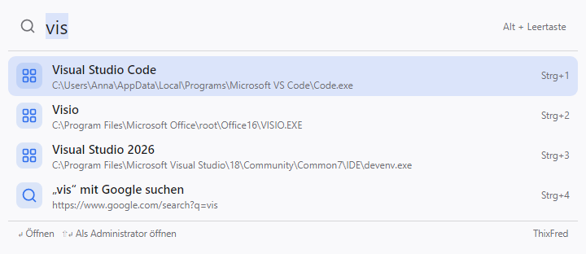
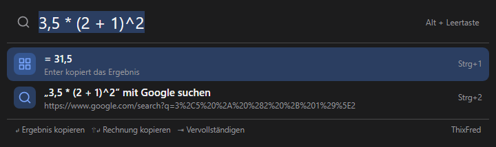
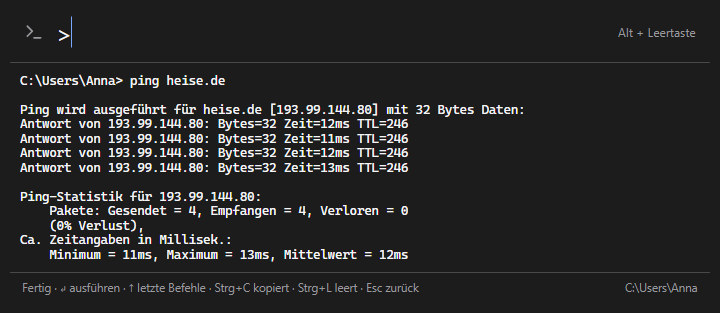
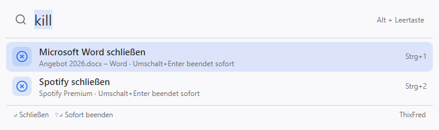
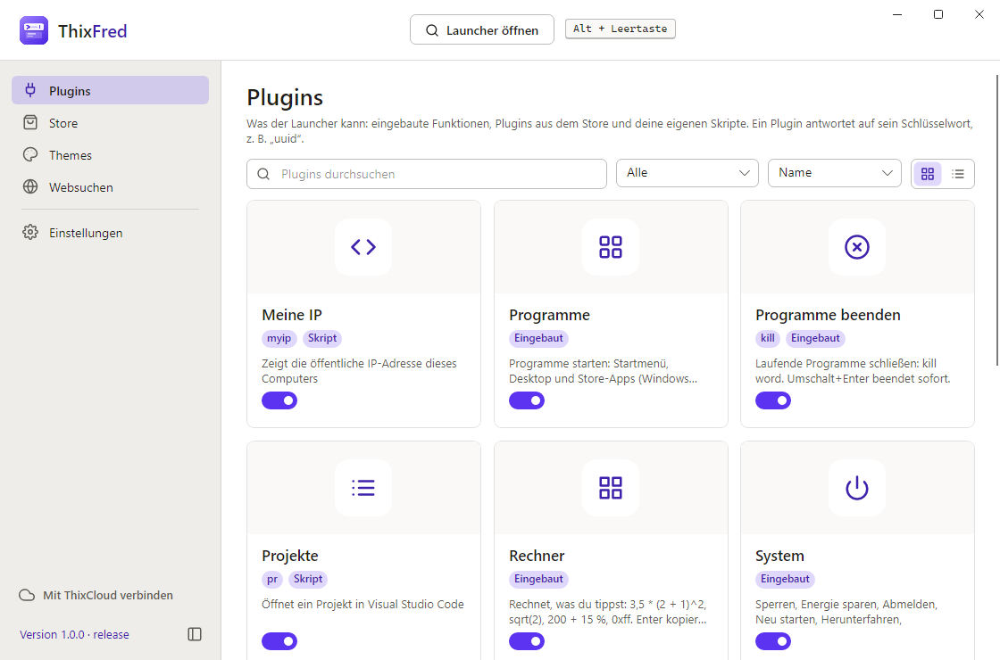
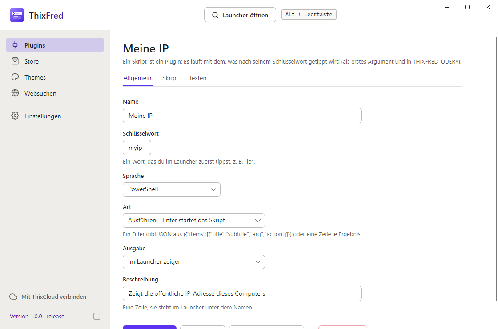
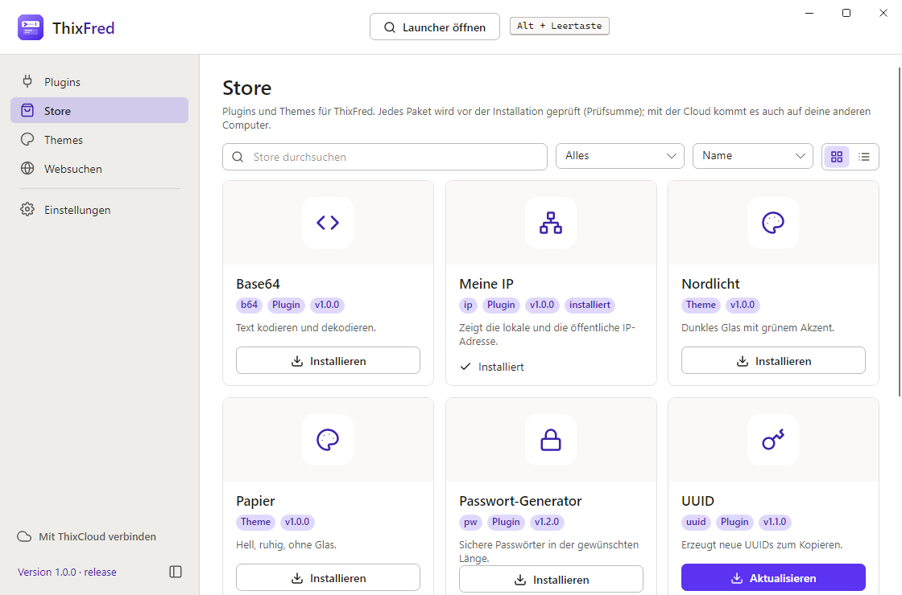
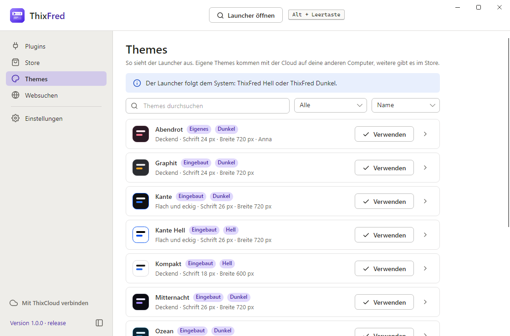
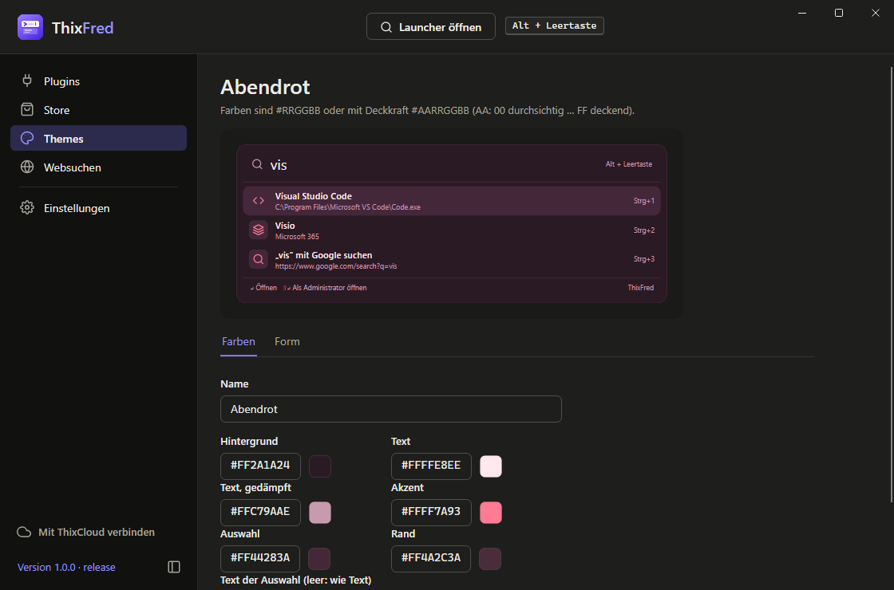
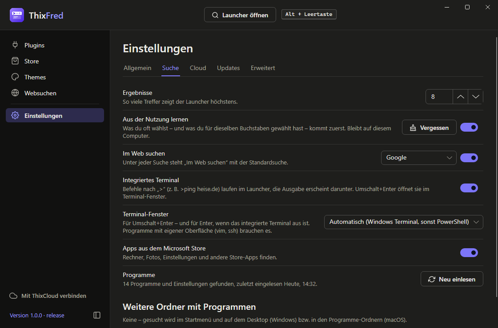

<p align="center"></p>

# ThixFred

**Der Launcher für Windows und macOS** – ein Tastenkürzel, ein Suchfeld, sofort da. Programme starten und beenden, rechnen,
Befehle im Terminal ausführen, im Web suchen; dazu Themes, Plugins mit eigenem Store, deine eigenen Skripte und auf Wunsch
die **ThixCloud** (MatCloud), damit ThixFred auf allen deinen Computern gleich eingerichtet ist.

| Programme | Rechnen | Terminal | Programme beenden |
|---|---|---|---|
|  |  |  |  |

- **Schnell wie nichts**: das Fenster wird beim Start einmal gebaut und danach nur gezeigt; der Programmindex liegt im
  Speicher (beim Start sofort aus dem Cache, im Hintergrund neu eingelesen) – die Suche läuft bei jedem Tastendruck ohne
  Festplatte und Netz. Getrimmtes, vorkompiliertes Programm (ReadyToRun).
- **Programme starten**: Startmenü, Desktop und Microsoft-Store-Apps (Windows), die Programme-Ordner (macOS), weitere Ordner
  nach Wahl, Einstellungsseiten von Windows („Bluetooth“, „Geräte-Manager“). Gefunden wird nach Anfang, Wortanfang,
  Initialen (`vsc` → Visual Studio Code), Dateiname und Buchstaben in Reihenfolge; Umschalt+Enter startet als Administrator.
- **Lernt mit**: Was du für dieselben Buchstaben gewählt hast, kommt zuerst; ein leeres Suchfeld zeigt das zuletzt Genutzte.
- **Programme beenden**: `kill word` (auch `beenden …`, `quit …`) – Enter schließt, Umschalt+Enter beendet sofort (nach Rückfrage).
- **Rechnen**: `3,5 * (2 + 1)^2`, `sqrt(2)`, `200 + 15%`, `0xff`, `5!`, `max(1; 7)` – Enter kopiert das Ergebnis.
- **Integriertes Terminal**: `>ping heise.de` läuft direkt im Launcher, die Ausgabe erscheint live darunter; die Zeile
  nimmt dann den nächsten Befehl (`↑` die letzten), `cd` bleibt, Eingaben gehen an den laufenden Befehl, `Strg+C` bricht
  ab, `Strg+L` leert. Umschalt+Enter öffnet den Befehl in Windows Terminal / PowerShell / cmd bzw. Terminal / iTerm (für
  Programme mit eigener Oberfläche wie vim oder ssh); abschaltbar unter Einstellungen › Suche.
- **Web**: `heise.de` öffnet die Adresse, `g …`, `wiki …`, `yt …` suchen mit Schlüsselwort (eigene Websuchen anlegen) –
  der Anfang genügt (`w alfred` → Wikipedia), „Im Web suchen“ steht unter jeder Suche.
- **System**: Sperren, Energie sparen, Abmelden, Neu starten, Herunterfahren, Papierkorb leeren (mit Rückfrage, wo es Arbeit kostet).
- **Themes**: neun eingebaute (hell, dunkel, Glas mit Acryl/Mica, kompakt, **Kante** und **Kante Hell**: flach und eckig,
  die Auswahl vollflächig in der Akzentfarbe), eigene mit Live-Vorschau, weitere im Store.
- **Plugins und Skripte**: Ein Plugin ist ein Ordner mit `plugin.json` – oder einfach **ein Skript** (PowerShell, cmd, bash,
  zsh, Python, Node) mit Kopfzeilen `@name`, `@keyword` … Es läuft mit Enter oder liefert beim Tippen eigene Ergebnisse
  (JSON oder eine Zeile je Treffer). Skripte schreibst und testest du direkt in ThixFred.
- **Store**: Plugins und Themes mit Prüfsumme, Updates, Entfernen; eine eigene Store-Adresse (z. B. der Firma) geht auch.
  Das Schlüsselwort eines Store-Plugins, das noch fehlt (`ip`), bietet die Installation an – Enter, und es läuft.
- **ThixCloud**: Einstellungen, Themes, Websuchen, deine Skripte und die Store-Pakete auf allen PCs und Macs gleich –
  angemeldet im Browser mit Code (oder Benutzername und Passwort). Tastenkürzel und Fenster bleiben je Computer.
- **Tray / Menüleiste**, **Autostart**, **Setup** (Windows) bzw. **App-Bundle + DMG** (macOS), **OTA-Updates** mit optionalem
  **Full-Auto-Update**, Richtlinien für Administratoren.

| Plugins | Skript schreiben | Store |
|---|---|---|
|  |  |  |

| Themes | Theme bearbeiten | Einstellungen › Suche |
|---|---|---|
|  |  |  |

## Bedienung per Tastatur

| Taste | Wirkung |
|---|---|
| `Alt + Leertaste` / `⌥ Leertaste` | Launcher öffnen / schließen (global, einstellbar) |
| tippen | suchen |
| `↑` `↓` `Bild↑` `Bild↓` | Ergebnis wählen |
| `Enter` / Klick | ausführen (öffnen, kopieren, im Terminal ausführen …) |
| `Umschalt + Enter` | die zweite Aktion: als Administrator, im Ordner zeigen, sofort beenden, Rechnung kopieren |
| `Strg/⌘ + 1` … `9` | das n-te Ergebnis sofort ausführen |
| `Tab` | vervollständigen (`wiki` → `wiki `, ein früherer Befehl) |
| `Esc` | zurück (Meldung, Rückfrage), Suche leeren, dann schließen |
| `Strg/⌘ + ,` | Einstellungen |
| `Strg/⌘ + C` | eine Ausgabe im Launcher kopieren |
| im Terminal | `Enter` ausführen bzw. Eingabe senden · `↑` `↓` letzte Befehle · `Strg + C` abbrechen · `Strg + L` leeren · `Bild↑` `Bild↓` blättern · `Esc` zurück |

Im Einstellungsfenster: `Strg/⌘ + 1 … 4` Plugins, Store, Themes, Websuchen · `Strg/⌘ + ,` Einstellungen · `Strg/⌘ + F` Suche
der Liste · `Strg/⌘ + B` Menü einklappen · `Esc` zurück. Die Version unten links („Version 1.0.0 · release“) öffnet „Über ThixFred“.

## Eigene Skripte

Ein Skript im Ordner `scripts` (Einstellungen › Erweitert) – oder über **Plugins › Neues Skript**:

```powershell
# @name Meine IP
# @keyword myip
# @mode run
# @output launcher
# @description Zeigt die öffentliche IP-Adresse

(Invoke-RestMethod https://api.ipify.org?format=json).ip
```

`myip` + Enter zeigt die Ausgabe im Launcher. Mit `@mode filter` läuft es beim Tippen und gibt seine Ergebnisse aus
(Format und Plugins mit Ordner: [store/README.md](store/README.md)).

## Installation

**Windows** – `ThixFredSetup.exe` aus dem [Release-Kanal](https://github.com/Real-TTX/ThixFred/releases/tag/release-channel)
starten. Installiert pro Benutzer nach `%LocalAppData%\Programs\ThixFred` (ohne Administratorrechte), mit Startmenü,
„Installierte Apps“, optional Autostart, Desktop-Verknüpfung und automatischen Updates (vorausgewählt).

**macOS** – `ThixFred-macOS-arm64.dmg` (Apple Silicon) bzw. `-x64.dmg` (Intel) öffnen und ThixFred in „Programme“ ziehen.
ThixFred lebt in der Menüleiste. Die App ist (noch) ad hoc signiert: beim ersten Start Rechtsklick › Öffnen.

**ThixCloud** – die Cloud der Thix-Apps ist **MatCloud** (eigenes Repository, Docker, Port 4950). Unter Einstellungen › Cloud
die Adresse eingeben und **„Im Browser anmelden“**: ThixFred zeigt einen Code und öffnet die Seite der Cloud; dort anmelden
und bestätigen. Alternativ mit Benutzername und Passwort.

## Versionen, Kanäle, Updates

| Branch | Version | Desktop-Kanal |
|---|---|---|
| `main` | `0.1.<build>-<datum>` (z. B. `0.1.42-20261117`) | `release-channel` + Release `v<version>` |
| `dev` | `nightly-<build>-<datum>` | `nightly-channel` |
| sonst / lokal | `local-<datum>` | – (keine Updates) |

Jede installierte Version prüft beim Start und alle 6 Stunden ihren eigenen Kanal (abschaltbar); mit „Updates automatisch
installieren“ (Full-Auto-Update) wird ohne Rückfrage aktualisiert und neu gestartet. Der Store hat seinen eigenen Kanal
(`store-channel`, gebaut aus [store/](store/)).

## Für Administratoren

Richtlinien (Wert 1): Windows `HKLM\SOFTWARE\Policies\ThixFred`, macOS Konfigurationsprofil `info.schmoldt.thixfred`.

| Richtlinie | Wirkung |
|---|---|
| `LockConfiguration` | Einstellungen nur lesbar |
| `DisableCloud` | keine Verbindung zur ThixCloud |
| `DisableUpdates` | keine Update-Prüfung, keine Installation |
| `DisableScripts` | keine Plugins und Skripte (die eingebauten Funktionen bleiben), kein Store |
| `DisableStore` | kein Store |

## Entwicklung

```bash
dotnet build ThixFred.slnx
dotnet test tests/ThixFred.Tests
dotnet run --project src/ThixFred -- --snapshot docs/images   # alle Bilder, ohne Bildschirm
node tools/store-build.js artifacts/store                       # den Store bauen
```

- `dotnet test` – Suche, Rechner, Plugins, Skripte (die Store-Plugins laufen unter Windows wirklich), Store (Prüfsumme, Pfade),
  Themes, Websuchen, die ThixCloud gegen eine MatCloud im Speicher und die Oberfläche headless gerendert (Tastatur-Abläufe;
  mit `THIXFRED_SCREENSHOTS=<ordner>` Screenshots).
- `THIXFRED_DATA_DIR=<ordner>` startet eine eigene Instanz mit eigenem Datenordner.
- `ThixFred.exe --self-test <bericht.txt>` prüft das veröffentlichte (getrimmte) Programm; die CI führt das bei jedem Windows-Build aus.
- Logo und Icons: [branding/](branding/README.md). Aufbau und Regeln: [CLAUDE.md](CLAUDE.md).

© Matthias Schmoldt
